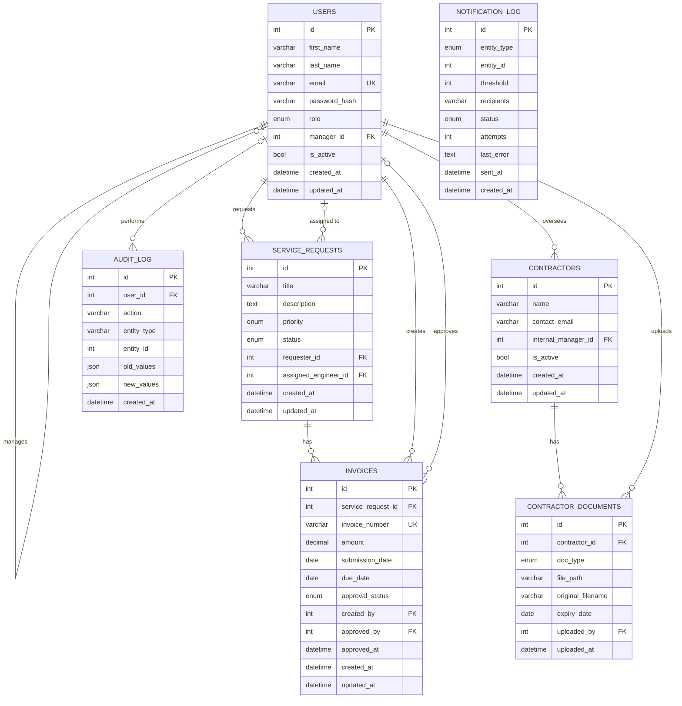

# Database Design (ERD)

MySQL 8, InnoDB, utf8mb4. All timestamps stored in UTC.

## Tables

### users
| Column | Type | Notes |
|---|---|---|
| id | INT PK AUTO_INCREMENT | |
| first_name | VARCHAR(75) NOT NULL | used in greetings ("Hello, Abdullah") |
| last_name | VARCHAR(75) NOT NULL | full name = first_name + last_name, built when displayed |
| email | VARCHAR(255) NOT NULL UNIQUE | login |
| password_hash | VARCHAR(255) NOT NULL | bcrypt, never the plain password |
| role | ENUM('operations','engineer','manager','admin') NOT NULL | |
| manager_id | INT NULL FK → users.id | an engineer's manager |
| is_active | BOOLEAN NOT NULL DEFAULT TRUE | deactivate instead of delete |
| created_at, updated_at | DATETIME | |

### service_requests
| Column | Type | Notes |
|---|---|---|
| id | INT PK | |
| title | VARCHAR(200) NOT NULL | |
| description | TEXT NOT NULL | |
| priority | ENUM('low','medium','high') NOT NULL | |
| status | ENUM('open','assigned','in_progress','resolved','closed') NOT NULL DEFAULT 'open' | |
| requester_id | INT NOT NULL FK → users.id | stored as id; API returns `requester_name` |
| assigned_engineer_id | INT NULL FK → users.id | null until assigned; API returns `assigned_engineer_name` |

Names are stored once in `users` and joined in when displayed. Storing ids avoids duplicate-name clashes and keeps names correct if a user's name changes. The UI shows name + email when picking an engineer.
| created_at, updated_at | DATETIME | |

### invoices
| Column | Type | Notes |
|---|---|---|
| id | INT PK | |
| service_request_id | INT NOT NULL FK → service_requests.id | |
| invoice_number | VARCHAR(50) NOT NULL UNIQUE | |
| amount | DECIMAL(12,2) NOT NULL | in SAR; never FLOAT for money |
| submission_date | DATE NOT NULL | |
| due_date | DATE NULL | aging uses this, falls back to submission_date |
| approval_status | ENUM('pending','approved','rejected') NOT NULL DEFAULT 'pending' | |
| created_by | INT NOT NULL FK → users.id | engineer who added it |
| approved_by | INT NULL FK → users.id | manager who approved/rejected |
| approved_at | DATETIME NULL | |
| created_at, updated_at | DATETIME | |

Age and aging band are **computed**, not stored.

### contractors
| Column | Type | Notes |
|---|---|---|
| id | INT PK | |
| name | VARCHAR(200) NOT NULL | |
| contact_email | VARCHAR(255) NOT NULL | receives expiry alerts |
| internal_manager_id | INT NOT NULL FK → users.id | receives expiry alerts |
| is_active | BOOLEAN NOT NULL DEFAULT TRUE | |
| created_at, updated_at | DATETIME | |

### contractor_documents
| Column | Type | Notes |
|---|---|---|
| id | INT PK | |
| contractor_id | INT NOT NULL FK → contractors.id | |
| doc_type | ENUM('HIP','JSA','CCSP','CWQAP','JOB_X') NOT NULL | |
| file_path | VARCHAR(500) NOT NULL | file stored on disk, path here |
| original_filename | VARCHAR(255) NOT NULL | |
| expiry_date | DATE NOT NULL | |
| uploaded_by | INT NOT NULL FK → users.id | |
| uploaded_at | DATETIME | |

Status (valid / expiring soon / expired) is **computed**, not stored. A new upload of the same type keeps the old row as history; the latest upload is the current one.

### notification_log
| Column | Type | Notes |
|---|---|---|
| id | INT PK | |
| entity_type | ENUM('invoice','document') NOT NULL | |
| entity_id | INT NOT NULL | id in invoices or contractor_documents |
| threshold | INT NOT NULL | 30 / 60 / 180 for invoices, 30 for documents |
| recipients | VARCHAR(1000) NOT NULL | |
| status | ENUM('pending','sent','failed') NOT NULL | |
| attempts | INT NOT NULL DEFAULT 0 | |
| last_error | TEXT NULL | |
| sent_at | DATETIME NULL | |
| created_at | DATETIME | |

UNIQUE (entity_type, entity_id, threshold) is what guarantees one alert per threshold. `entity_id` has no FK because it points to two different tables.

### audit_log
| Column | Type | Notes |
|---|---|---|
| id | INT PK | |
| user_id | INT NULL FK → users.id | null for system actions (jobs) |
| action | VARCHAR(50) NOT NULL | create / update / delete / approve / assign ... |
| entity_type | VARCHAR(50) NOT NULL | |
| entity_id | INT NOT NULL | |
| old_values | JSON NULL | |
| new_values | JSON NULL | |
| created_at | DATETIME NOT NULL | |

Append-only: rows are never updated or deleted.

## Indexes
| Table | Index | Why |
|---|---|---|
| service_requests | assigned_engineer_id | engineer's list, filter by engineer |
| service_requests | requester_id | operations user's own list |
| service_requests | status | filter by status, dashboard counts |
| service_requests | created_at | filter and sort by date |
| invoices | service_request_id | invoices of an SR |
| invoices | (approval_status, due_date) | daily aging job |
| contractor_documents | (contractor_id, doc_type) | current document per type |
| contractor_documents | expiry_date | daily expiry job |
| notification_log | UNIQUE (entity_type, entity_id, threshold) | no duplicate alerts |
| audit_log | (entity_type, entity_id) | history of one record |
| audit_log | created_at | audit page sorted by time |

Foreign key columns are indexed by InnoDB automatically; they are listed here for clarity.
